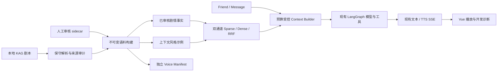

# AIlover：当前架构与 Phase 1 审计记录

当前Phase1–4工程链路和命令见 [最终交付](PHASE4_DELIVERY.md)。当前Django Message/Friend/MemoryItem为事实来源，完成消息和MemoryJob同事务保存；epoch/水位/租约应对人工遗忘与后台恢复；无LangGraph checkpoint双历史。HTTP编排负责上下文、持久化和清理，保留图的模型/工具职责。

语音为token→句缓冲→单轮TTS→UUID/seq SSE→有序播放器，文字独立。私有debug按用户/Friend/generation查看本轮证据和有效记忆，默认关闭。离线消融使用独立临时库，关系/情绪不自动增长。以下是Phase1历史设计，缺少新表/证据接口的描述仅适用于当时。

## Phase 1 历史记录

本文记录 Phase 1 的历史交付；当前 Phase 2 已新增记忆表与 migration，详见 [结构化记忆](MEMORY.md)。以下“没有新表/未执行真实迁移”的描述仅适用于 Phase 1。

当前 Phase 3 的流式语音模块、取消注册和异步模型节点见 [VOICE.md](VOICE.md)；没有额外语音数据库表或独立运行服务。

本轮在已有未提交工作上增量开发，保留 Django / DRF、Vue 3、LangGraph、SQLite 和 LanceDB。没有增加运行服务、模型训练或新的 Django 表；没有修改真实 `.env`、执行真实数据库迁移、清空记录或发布游戏素材。

## 审计结果与实施顺序

实际检查了剧本解析、角色清洗、检索、聊天流、图状态、记忆更新、管理命令、测试、前端播放器与桌面打包配置。主要问题：旧解析只读 `main/*.ks` 的带标记单句，丢失行号、旁白上下文与控制流；本地词法检索会在零命中时按哈希填充台词；聊天无统一预算；记忆是摘要与 revision 乐观锁，仍由后台线程更新；语音将 token 直接送给云端流式 TTS，尚无句子缓冲和完善的逐轮协议。

Phase 1 先完成数据、双通道检索、上下文和离线验证。Phase 2 才设计有迁移的结构化记忆；Phase 3 做语音取消和队列；Phase 4 扩充真实评测与诊断。当前没有重构 LangGraph 为复杂多智能体，也没有引入 checkpoint：Django Message / Friend 继续作为聊天事实来源，避免两套历史。

## 模块与数据流

| 模块 | 输入与输出 | 责任 |
| --- | --- | --- |
| `story_pipeline.py` | `.ks` → records / examples / lore / manifest / audit | 文件位置、哈希、条件边界、未知信息、增量解析缓存、审核合并、原子发布 |
| `story_retriever.py` | 角色、问题、recent、filters → `(structured_hits, trace)` | CJK postings、词组映射、LanceDB 独立表、RRF、过滤与降级 |
| `context_builder.py` | 角色约束、消息、两类证据、旧记忆 → messages / budget trace | 优先级、完整近期消息对、去重、身份模式、资料与指令分离 |
| `chat.py` | 已鉴权的当前 Friend → SSE | 先读取历史再构造上下文；请求 ID、开发 trace、现有完成消息落库 |
| `retrieval_evaluation.py` | 显式合成 records / gold cases → ablation report | Recall / MRR / nDCG / 无关注入 / 延迟 |

图输入只含 `messages`；HTTP trace 不进入 LangGraph 状态。没有新的聊天状态持久化或用户记忆自动写入。原作 Lore 只读，不接受聊天工具修改。固定角色和行为约束在 SystemMessage；检索资料和记忆以 JSON HumanMessage 输入，近期历史保持原有角色。该隔离降低指令混淆，但不能保证任何模型绝对免疫提示注入，仍需真实对抗评测。

## 检索决策

- Lore / Style / Voice 使用独立文件；Dense 使用资料内容与配置模型/维度/端点指纹命名的独立 LanceDB 表，防止旧索引对应新资料或不同 Embedding 配置。
- Sparse 用 CJK 二元片段、单字查询回退和英文词；posting lists 根据文件修改时间缓存。不依赖英文 FTS tokenizer，不要求 SQLite 支持 trigram。
- 中日主题词和人物别名采用可审核的显式映射；这不是通用跨语言语义检索。
- 当前问题必须命中才进入 Sparse 候选；最近对话只加权已有候选，不会独立激活无关资料。
- 默认 Hybrid，Dense 默认关闭。开启后采用距离门限；门限 `0.8` 是待校准配置，不是通用准确率保证。Dense 失败或缺失可回退 Sparse。
- 元数据在融合前过滤；未知 route 不满足已知 route；未指定 route 不注入特定 route；条件分支未推断路径，默认排除。场景可通过内部 filters 显式指定，聊天暂不自动推断路线/场景。
- 候选上限 64、返回上限 16、同文去重；RRF 常数 60。可注入 reranker，但不得增加候选或改写证据。
- Context 默认 16,000 UTF-8 字节保守 token 上界，包括固定约束、当前输入、历史和资料。不是实际 tokenizer 测量；模型输出余量需与提供商的上下文窗口另行核对。

## 兼容性与风险

`ROLEPLAY_RAG_MODE=legacy` 回退原有单句检索，`off` 关闭原作检索；无命中随机填充已修复。现有 `build_style_index`、seed、导出、搜索、登录、记忆 revision 均保留。旧 `Friend.memory` 仍按记忆开关使用，没有迁移或偷偷解析成结构化事实。

当前默认 bundle 在运行时 DATA_DIR 外置目录 `story_data`，可由 `STORY_DATA_DIR` 指定。新游戏语料不放进 `web/` 或 PyInstaller datas，避免自动随包分发。新模块位于现有打包收集目录；本轮验证前端构建，尚未构建/运行 Windows EXE，不能宣称桌面集成已验收。

新功能开发 trace 同时要求后端 DEBUG、显式 `ROLEPLAY_DEBUG_TRACE=true`、前端 DEV 与 `VITE_ROLEPLAY_DEBUG=true`。使用已鉴权聊天流，没有新增开放诊断接口。只含请求/角色/命中 ID、预算、降级原因与流消费侧延迟；不输出密钥、完整用户文本或原作文本。面板尚无证据正文/逐条记忆来源查看，这些需后续权限设计。
